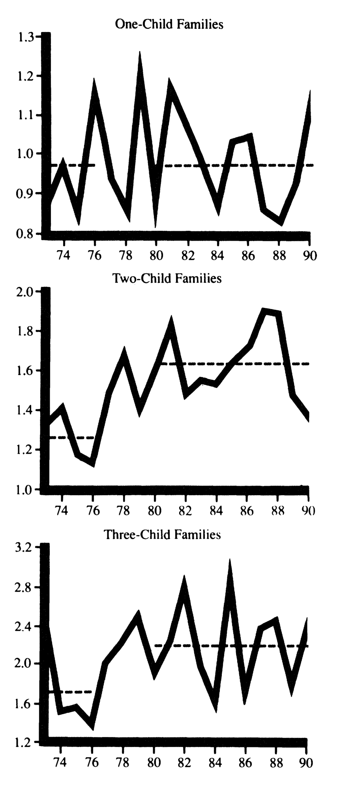
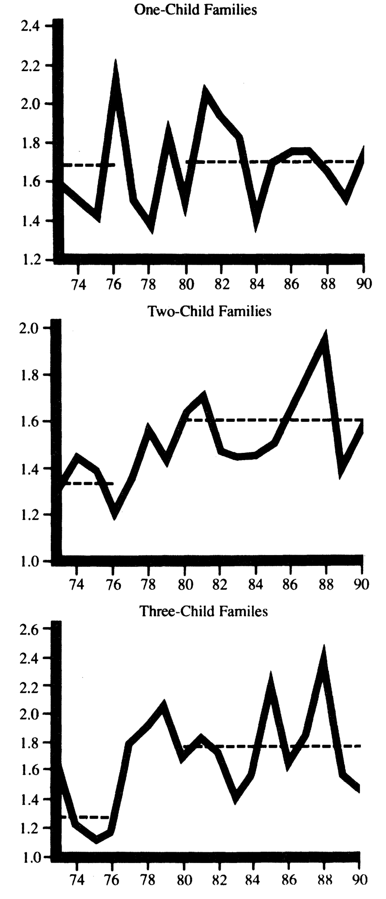
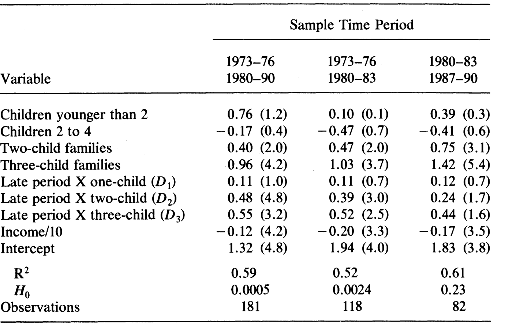
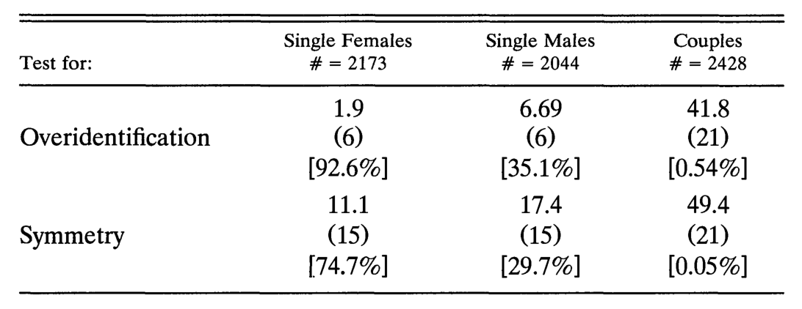
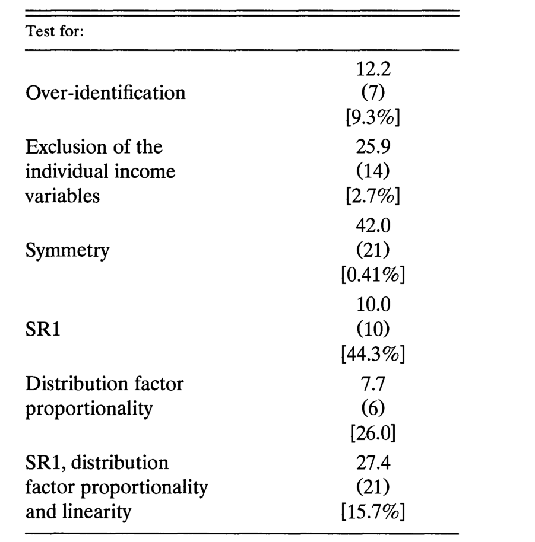
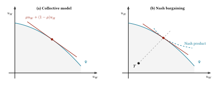
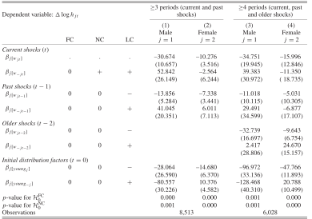
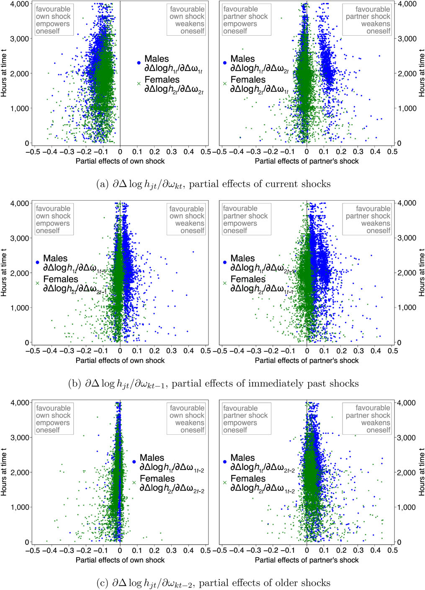

# 5  家計内配分

Code

Unitary and Collective Models, Nash Bargaining, and Commitment

## 5.1 Unitary model vs. Collective model

Chiappori and Mazzocco ([2017](#ref-chiappori2017c)) を参照しながら, 家計内配分の理論を整理します. 次の設定を考えます

- 妻 \\W\\ と夫 \\H\\ がそれぞれ効用関数 \\u_W\left(\boldsymbol{q}\_W, \boldsymbol{Q}\right)\\, \\u_H\left(\boldsymbol{q}\_H, \boldsymbol{Q}\right)\\ を持つ. \\\boldsymbol{q}\_j\\ は私的財, \\\boldsymbol{Q}\\ は公共財のベクトル
- 家計の予算制約のもとで実現可能な効用の組の集合を \\\mathcal{U}\\ とする. \\\mathcal{U}\\ は凸でコンパクト
- Pareto フロンティアは減少関数 \\u_H = \Psi\left(u_W\right)\\ で表せるとする

### 5.1.1 Unitary model

伝統的な消費者理論を家計にそのまま適用すると, 家計は1つの効用関数 \\U\left(\boldsymbol{q}\_W, \boldsymbol{q}\_H, \boldsymbol{Q}\right)\\ を予算制約 \\ \boldsymbol{p} \cdot \left(\boldsymbol{q}\_W + \boldsymbol{q}\_H\right) + \boldsymbol{P} \cdot \boldsymbol{Q} \leq y_W + y_H =: Y \\ のもとで最大化する主体になります. これを unitary model と呼びます ([Becker 1991](#ref-becker1991)). 家計が複数の個人からなることを意識していても, 合意された家族の効用関数 (Samuelson ([1956](#ref-samuelson1956)) の社会厚生関数) か, 全員の選好を考慮して決める家長 (Becker の利他的な dictator) を仮定すれば, 結果として家計は1人のように振る舞います. 観察できるのは家計の需要, すなわち価格 \\\boldsymbol{\pi} = \left(\boldsymbol{p}, \boldsymbol{P}\right)\\ と所得 \\Y\\ の関数としての総需要 \\\boldsymbol{q}\left(\boldsymbol{\pi}, Y\right) = \left(\boldsymbol{q}\_W + \boldsymbol{q}\_H, \boldsymbol{Q}\right)\\ です. Unitary model はこの需要関数に2つの強い制約を課します.

1.  **Income pooling.** 所得は合計 \\Y\\ だけが意思決定に影響し, 誰が稼いだか (\\y_W\\ と \\y_H\\ の内訳) は影響しない. 選好にも予算集合にも入らない変数 (結婚市場の性比, 離婚法制, 給付の帰属先) は需要に影響しない. こうした変数を後で distribution factor と呼ぶ.
2.  **Slutsky 対称性.** 財 \\l\\ の価格 \\\pi_l\\ が上がったときの財 \\k\\ の需要の変化は, 代替効果と所得効果に分解できる (Slutsky 分解). \\ \frac{\partial q_k}{\partial \pi_l} = \underbrace{\frac{\partial q^{c}\_k}{\partial \pi_l}}\_{\text{substitution effect}} \underbrace{- \\ q_l\\ \frac{\partial q_k}{\partial Y}}\_{\text{income effect}} \\ ここで \\q^{c}\_k\left(\boldsymbol{\pi}, u\right)\\ は, 効用を \\u\\ に保つように所得を補償したときの需要 (補償需要, Hicksian demand. 上付きの \\c\\ は compensated の意味) で, 実際の効用水準 \\u = v\left(\boldsymbol{\pi}, Y\right)\\ で評価する. 価格 \\\pi_l\\ が上がると, 買っている量 \\q_l\\ に比例して実質所得が目減りするので, 所得効果は \\-q_l\\ \partial q_k / \partial Y\\ になる. 代替効果を並べた行列 \\ S\_{kl}\left(\boldsymbol{\pi}, Y\right) = \frac{\partial q^{c}\_k}{\partial \pi_l} = \frac{\partial q_k}{\partial \pi_l} + q_l\\ \frac{\partial q_k}{\partial Y} \tag{5.1}\\ を Slutsky 行列と呼ぶ. 2つ目の等号は Slutsky 分解を移項したもので, 観察できる需要 \\\boldsymbol{q}\\ だけから \\S\\ を計算できることを表す. この Slutsky 行列 \\S\\ は対称かつ負値半定符号である.

Slutsky 対称性の意味は, 財として夫婦それぞれの余暇をとると見えやすくなります. 私的財 \\\boldsymbol{q}\_W, \boldsymbol{q}\_H\\ は夫婦が同じ価格 \\\boldsymbol{p}\\ で買うので, 価格を動かしても「誰の選好が効いているか」は分かりません. これに対して余暇の価格は各人の賃金です. 1人あたりの時間を \\T\\, 非労働所得を \\y\\ として, 家計が \\U\left(c, l_W, l_H\right)\\ を予算制約 \\ c + w_W l_W + w_H l_H = y + \left(w_W + w_H\right) T \\ のもとで最大化するとします. 妻と夫の余暇についての Slutsky 行列の要素を \\S\_{WH}, S\_{HW}\\ と書くと, 対称性 \\S\_{WH} = S\_{HW}\\ は \\ \frac{\partial l_W}{\partial w_H} - h_H\\ \frac{\partial l_W}{\partial y} = \frac{\partial l_H}{\partial w_W} - h_W\\ \frac{\partial l_H}{\partial y} \\ となります. ここで \\h_j = T - l_j\\ は労働時間で, 微分は非労働所得 \\y\\ を一定にしたものです. 夫の賃金が上がったときの妻の余暇の (補償された) 反応と, 妻の賃金が上がったときの夫の余暇の反応が等しい, という関係です. しかし, 実際には夫の賃金の上昇は夫の発言権を高める効果があるとすると, 妻の余暇には「夫の選好の比重が増える」効果が加わり, 対称性は成り立たなくなります. Unitary model は, 家計の中に1つの効用関数を最大化する主体がいる限り, こうした目に見えにくい制約を課します.

### 5.1.2 Collective model

これに対して collective model ([Chiappori 1988](#ref-chiappori1988), [1992](#ref-chiappori1992)) は, 家計が異なる選好を持つ個人の集合であることを明示し, 特定の交渉メカニズムを仮定する代わりに, 結果としての配分が Pareto 効率的であることだけを公理とします.

**命題 5.1 (効率性と加重和最大化の双対性)** \\\mathcal{U}\\ が凸のとき, 配分 \\\left(u_W^\*, u_H^\*\right) \in \mathcal{U}\\ が Pareto 効率的であることは, ある Pareto ウェイト \\\mu \in \left\[0, 1\right\]\\ が存在して \\ \left(u_W^\*, u_H^\*\right) \in \arg\max\_{\left(u_W, u_H\right) \in \mathcal{U}}\\ \mu\\ u_W + \left(1 - \mu\right) u_H \tag{5.2}\\ となることと同値である.

証明は[付録](../../lesson/appendix/proof.llms.md#prf-collective)にあります.

つまり collective model の家計問題は \\ \begin{aligned} \max\_{\boldsymbol{q}\_W, \boldsymbol{q}\_H, \boldsymbol{Q}}\\ & \mu\left(\boldsymbol{\pi}, Y, \boldsymbol{z}\right) u_W\left(\boldsymbol{q}\_W, \boldsymbol{Q}\right) + \left(1 - \mu\left(\boldsymbol{\pi}, Y, \boldsymbol{z}\right)\right) u_H\left(\boldsymbol{q}\_H, \boldsymbol{Q}\right) \\ \text{s.t.}\\ & \boldsymbol{p} \cdot \left(\boldsymbol{q}\_W + \boldsymbol{q}\_H\right) + \boldsymbol{P} \cdot \boldsymbol{Q} \leq Y \end{aligned} \\ と書け, フロンティア上の位置の選択はすべて \\\mu\\ に集約されます. \\\mu\\ は「交渉力」の指標であり, 価格 \\\boldsymbol{\pi}\\ と所得 \\Y\\ のほか, 選好にも予算集合にも影響しないが交渉力にだけ影響する変数のベクトル \\\boldsymbol{z}\\, すなわち **distribution factor** (結婚市場の性比, 離婚法制, 給付の帰属先など) に依存してよいとします. 実は[sec-gmm-micro](#sec-gmm-micro)節で GMM によって推定した二人家計のモデルは, まさにこの collective model であり, そこで推定した \\\mu\\ がここでの Pareto ウェイトです.

Collective model は unitary model を特殊ケースとして含みます. Pareto ウェイトが動かなければ, 加重和そのものが家族の効用関数になるからです.

**命題 5.2 (Unitary model は collective model の特殊ケース)** Collective model の Pareto ウェイトが価格・所得・distribution factor によらない定数 \\\mu\left(\boldsymbol{\pi}, Y, \boldsymbol{z}\right) = \bar{\mu} \in \left\[0, 1\right\]\\ であるとする. このとき家計の需要は, 家族の効用関数を \\ U\left(\boldsymbol{q}\_W, \boldsymbol{q}\_H, \boldsymbol{Q}\right) = \bar{\mu}\\ u_W\left(\boldsymbol{q}\_W, \boldsymbol{Q}\right) + \left(1 - \bar{\mu}\right) u_H\left(\boldsymbol{q}\_H, \boldsymbol{Q}\right) \tag{5.3}\\ とした unitary model の需要に一致し, income pooling と Slutsky 対称性がともに成り立つ.

証明は[付録](../../lesson/appendix/proof.llms.md#prf-collective-unitary)にあります.

特に \\\bar{\mu} = 1/2\\ とすると, 家族の効用関数は2人の効用の単純な和 \\u_W + u_H\\ (の \\1/2\\ 倍), すなわち夫婦の効用を等しい重みで足し合わせる (功利主義的な) 家族の効用関数になります. ただし, 家計が unitary になるのは \\\mu\\ が動かないからで, その値が \\1/2\\ だからではありません. \\\mu = 0.3\\ で固定された家計も unitary です. そもそも \\\mu\\ の値は効用の尺度に依存します ([Browning et al. 2014](#ref-browning2014)). 妻の効用を \\2 u_W\\ に取り替えても妻の選好は変わりませんが, \\\mu = 1/2\\ での加重和 \\\left(2 u_W + u_H\right) / 2\\ は元の効用で \\\mu = 2/3\\ とおいた加重和 \\\left(2 u_W + u_H\right) / 3\\ に比例するので, 同じ配分を選ぶウェイトは \\1/2\\ から \\2/3\\ に変わります. したがって \\\mu\\ を交渉力と読めるのは「\\\mu\\ が大きいほど妻の交渉力が強い」という大小の比較の意味においてで, \\1/2\\ という水準そのものが対等を意味するわけではありません ([Browning et al. 2014](#ref-browning2014); [Chiappori and Mazzocco 2017](#ref-chiappori2017c)).

逆に言えば, collective model が unitary model より一般的なのは, \\\mu\\ が価格・所得・distribution factor に反応することを許す点です. 次の節で見る income pooling の破れと Slutsky 行列のランク \\1\\ の項は, どちらも \\\mu\\ が動くことから生じます.

### 5.1.3 Collective model の含意

Collective model は unitary model より弱い仮定しか置きませんが, それでも家計需要に検定可能な制約を課します ([Browning and Chiappori 1998](#ref-browning1998)). 鍵になるのは, 価格・所得・distribution factor が家計行動に効く経路が2つあることです. 1つは予算制約を通じる経路, もう1つは Pareto ウェイト \\\mu\left(\boldsymbol{\pi}, Y, \boldsymbol{z}\right)\\ を通じる経路です. 価格と所得は両方の経路を持ちますが, distribution factor は定義により予算制約に入らないので, 2つ目の経路しか持ちません. この違いが検定可能な含意を生みます. 実際, ウェイトを固定したときの家計需要を \\\tilde{\boldsymbol{q}}\left(\boldsymbol{\pi}, Y, \mu\right)\\ と書くと, 観察される需要は \\ \boldsymbol{q}\left(\boldsymbol{\pi}, Y, \boldsymbol{z}\right) = \tilde{\boldsymbol{q}}\left(\boldsymbol{\pi}, Y, \mu\left(\boldsymbol{\pi}, Y, \boldsymbol{z}\right)\right) \tag{5.4}\\ です. ここで \\\tilde{\boldsymbol{q}}\left(\cdot, \cdot, \mu\right)\\ は, 加重和 \\\mu u_W + \left(1 - \mu\right) u_H\\ を家計の総消費 \\\left(\boldsymbol{q}, \boldsymbol{Q}\right)\\ について最大化した「collective な家計効用関数」を予算制約のもとで最大化する, 標準的な需要関数です. したがって \\\mu\\ を固定すれば通常の消費者理論がそのまま成り立ちます.

**Distribution factor とは.** 選好にも予算集合にも入らないが, 夫婦の交渉力 \\\mu\\ には影響しうる変数を distribution factor と呼びます. 典型例は所得の内訳です. 予算制約に入るのは総所得 \\Y = y_W + y_H\\ だけなので, 総所得を変えずに妻の取り分 \\y_W / Y\\ を増やしても, 家計が買える財の組み合わせは変わりません. それでも稼いでいる人の発言力が強くなるなら, \\y_W / Y\\ は \\\mu\\ を通じて消費を動かします. 総額を変えずに給付の受取人を夫から妻に変える改革, 結婚市場の性比, 離婚法制も同じ種類の変数です.

**2つのモデルの予測.** Distribution factor が需要に効くかどうかで, 2つのモデルの予測が分かれます.

- **Unitary model**: 家計は1つの効用関数を同じ予算集合のもとで最大化するので, distribution factor は需要に影響しません (\\\partial \boldsymbol{q} / \partial \boldsymbol{z} = 0\\). Distribution factor が妻の所得の割合 \\y_W / Y\\ だけの場合がちょうど income pooling です.
- **Collective model**: distribution factor は \\\mu\\ を通じて需要を動かせます. [式 eq-collective-demand](#eq-collective-demand) を \\z_k\\ で微分すると \\ \frac{\partial \boldsymbol{q}}{\partial z_k} = \frac{\partial \tilde{\boldsymbol{q}}}{\partial \mu}\\ \frac{\partial \mu}{\partial z_k} \tag{5.5}\\ となり, これは一般にゼロではありません. つまり income pooling は成り立つとは限りません.

**比例条件.** ただし collective model も何でも許すわけではありません. [式 eq-df-effect](#eq-df-effect) の右辺の第1因子 \\\partial \tilde{\boldsymbol{q}} / \partial \mu\\ は \\z_k\\ によらない共通のベクトルなので, どの distribution factor の効果もこのベクトルの定数倍になり, 違うのは倍率 \\\partial \mu / \partial z_k\\ だけです. 需要は1次元の \\\mu\\ を通じてしか動かないからです. したがって, 2つの distribution factor \\z_1, z_2\\ と2つの財 \\i, j\\ について \\ \frac{\partial q_i / \partial z_1}{\partial q_j / \partial z_1} = \frac{\partial q_i / \partial z_2}{\partial q_j / \partial z_2} = \frac{\partial \tilde{q}\_i / \partial \mu}{\partial \tilde{q}\_j / \partial \mu} \\ が成り立ちます (比例条件, proportionality). 例えば, 児童手当の受取人を夫から妻に変える改革 (\\z_1\\) で, 女性服の支出が子ども服の支出の2倍だけ増えたとします. Collective model のもとでは, この 2:1 という比は \\\partial \tilde{\boldsymbol{q}} / \partial \mu\\, つまり「妻の交渉力が上がったときに家計の支出がどう組み替わるか」で決まっており, どの distribution factor にも共通です. したがって, 結婚市場の性比 (\\z_2\\) の変化が女性服と子ども服を例えば 1:3 の比で動かしていたら, 2つの変数がどちらも1次元の交渉力 \\\mu\\ だけを通じて効いている, という collective model の構造と矛盾します. Distribution factor が1つしかなければ \\\partial \tilde{\boldsymbol{q}} / \partial \mu\\ の向きは自由に選べるので制約になりませんが, 2つ以上あると, この比の等しさとして検定できます ([Bourguignon et al. 2009](#ref-bourguignon2009)).

**Slutsky 行列.** 価格と所得についても同じ議論が使えます.

**命題 5.3 (Slutsky 行列の SR1 条件, Browning and Chiappori ([1998](#ref-browning1998)))**

1.  Collective model の家計需要 [式 eq-collective-demand](#eq-collective-demand) の Slutsky 行列 [式 eq-slutsky](#eq-slutsky) は, 対称で負値半定符号な行列 \\\Sigma\\ と, ランクが高々 \\1\\ の行列の和 \\ S\left(\boldsymbol{\pi}, Y\right) = \Sigma\left(\boldsymbol{\pi}, Y\right) + \boldsymbol{a}\\ \boldsymbol{b}^{\top}, \qquad \boldsymbol{a} = \frac{\partial \tilde{\boldsymbol{q}}}{\partial \mu}, \quad \boldsymbol{b} = \nabla\_{\boldsymbol{\pi}}\\ \mu + \boldsymbol{q}\\ \frac{\partial \mu}{\partial Y} \tag{5.6}\\ に分解できる (symmetric plus rank one, SR1).
2.  財の数を \\n\\ とし, 需要関数は \\\left(\boldsymbol{\pi}, Y\right)\\ について0次同次で, 予算制約を等号で満たすとする. このとき, \\n = 2\\ ならどんな需要関数の Slutsky 行列も対称であり, \\n \leq 4\\ ならどんな需要関数の Slutsky 行列も SR1 の形に分解できる. したがって, 対称性が需要に制約を課すのは \\n \geq 3\\ のとき, SR1 が制約を課すのは \\n \geq 5\\ のときに限られる.

証明は Browning and Chiappori ([1998](#ref-browning1998)) にあります (分解は Proposition 2, 財の数は Proposition 4).[^1]

分解の仕組みは比例条件と同じです. 所得を補償しながら価格 \\\pi_l\\ を上げると, 需要は2つの経路で動きます. 1つは \\\mu\\ を固定したままの効果で, これが \\\Sigma\\ の第 \\l\\ 列です. \\\mu\\ を固定した家計は1つの効用関数を最大化しているので, この部分は通常の消費者理論どおり対称になります. もう1つは \\\mu\\ が動くことによる効果 \\b_l \boldsymbol{a}\\ で, 比例条件のときと同じく, どの価格についても共通のベクトル \\\boldsymbol{a} = \partial \tilde{\boldsymbol{q}} / \partial \mu\\ の定数倍になります. 列がすべて \\\boldsymbol{a}\\ に比例するので, \\\boldsymbol{a}\\ \boldsymbol{b}^\top\\ のランクは高々 \\1\\ です. \\k + 1\\ 人の家計では相対的なウェイトが \\k\\ 次元になるので, 追加項のランクは高々 \\k\\ になります ([Browning and Chiappori 1998](#ref-browning1998), Proposition 5).

#### Collective Model の実証

モデルの含意は, 次のように検定されてきました.

- **Income pooling (unitary)**: 価格の変動を必要としないので, 最も多く検定されてきました. 妻と夫の非労働所得が需要に異なる効果を持つこと, 給付の受取人を夫から妻に変えた英国の児童手当改革で子ども服と女性服の支出が増えたことなど, ほぼ一貫して棄却されています ([Lundberg et al. 1997](#ref-lundberg1997)).
- **Slutsky 対称性 (unitary)**: 夫婦の家計の需要については, 繰り返し棄却されています. この検定は価格の外生性や分離可能性といった補助仮定に依存するので, 棄却を補助仮定のせいにすることもできます. しかし Browning and Chiappori ([1998](#ref-browning1998)) は, カナダの家計支出調査の単身男性・単身女性・夫婦の3つの部分標本に同じ検定をかけ, 単身者では対称性が棄却されず, 夫婦では強く棄却されることを示しました. 補助仮定は3つの標本に共通なので, 棄却は夫婦の意思決定の構造に由来すると考えられます.
- **SR1 (collective)**: 同じ研究で, 夫婦でも SR1 は棄却されていません.
- **比例条件 (collective)**: さまざまなデータで検定されてきましたが, 棄却されていません ([Bourguignon et al. 2009](#ref-bourguignon2009)).

**Income pooling の自然実験.** 稼ぎや資産所得の内訳は選好や働き方と無関係に決まるわけではないので, 所得の内訳が需要に効くという横断面の証拠には内生性の疑いが残ります. Lundberg et al. ([1997](#ref-lundberg1997)) は, 英国の児童手当改革を自然実験として使いました. 1977年4月より前の児童手当は, 母親に現金で払われる Family Allowance と, 父親の給与から源泉徴収される税を減らす Child Tax Allowance の2本立てでした. 1977年から1979年にかけて, この2つは母親に現金で払われる Child Benefit に一本化されます. 税控除を受けられるだけの所得がある子ども2人の家計では, 1972-73年度から1979-80年度にかけて, 夫への支払いが男性の平均年収の約 6% 分減り, 妻への支払いがほぼ同じだけ増えました. 夫婦が所得をプールしているなら, この受取人の変更は支出に影響しないはずです.

[図 fig-lundberg1997-ratio](#fig-lundberg1997-ratio) は, 英国の家計支出調査 (Family Expenditure Survey, FES) から, 子ども服と男性服, 女性服と男性服の支出の比を年ごとに描いたものです. 破線は改革前 (1973-76年) と改革後 (1980-90年) の平均です. 子どもが2人, 3人の家計では, 改革をはさんで比が一段上がり, その後は上昇のトレンドを持たずにその水準にとどまっています. 子どもが1人の家計では, はっきりした変化は見えません.

: Children’s to men’s clothing")

\(a\) Children’s to men’s clothing

: Women’s to men’s clothing")

\(b\) Women’s to men’s clothing

図 5.1: Clothing expenditure ratios, 1973-90

*出典:* Lundberg et al. ([1997](#ref-lundberg1997)) の Figure 1a, 1b.

[図 fig-lundberg1997-table4](#fig-lundberg1997-table4) は, これを回帰で確かめたものです. 観測値は個々の家計ではなく, FES が所得階級と子どもの数で区切って公表しているセルの平均で, 被説明変数は子ども服と男性服の支出の比です. 子どもの数と年齢構成, 所得を制御し, 改革後の期間を表すダミーと子どもの数のダミーの交差項 \\D_1, D_2, D_3\\ の係数で改革の効果を測ります. 括弧内は \\t\\ 値, \\H_0\\ の行は \\D_1 = D_2 = D_3 = 0\\ の同時検定の \\p\\ 値です. 1列目 (改革前 1973-76年, 改革後 1980-90年) では, 子ども2人, 3人の家計の係数が正で有意で, 3つの係数が同時に \\0\\ という仮説は 0.05% 水準で棄却されます. 2列目は, 改革後を 1980-83年に絞っても結果が変わらないことを示します. 3列目は, 改革をはさまない 1980-83年と 1987-90年を同じ方法で比べたプラセボで, ダミーは同時には有意ではありません (\\p = 0.23\\). 支出比の上昇が, もともとのトレンドではなく, 改革の時点での1回限りのシフトだったことを示しています. 女性服と男性服の比 (論文の Table 6) でも結論は同じです. 係数の大きさは, 子ども2人の家計で, 年 400 ポンドを超える夫から妻への移転に対して, 子ども服が年約 52 ポンド, 女性服が年約 27 ポンド増えたことに相当します.

図 5.2: Ratio of children’s to men’s clothing

*出典:* Lundberg et al. ([1997](#ref-lundberg1997)) の Table 4.

**単身者と夫婦の比較.** [図 fig-browning1998-unitary](#fig-browning1998-unitary) は, Browning and Chiappori ([1998](#ref-browning1998)) が unitary model の制約を3つの標本に同じように検定した結果です. 列は単身女性, 単身男性, 夫婦の標本で, 各セルは \\\chi^2\\ 統計量, 括弧内が自由度, 角括弧内が帰無仮説のもとでの確率 (\\p\\ 値) です. 1行目は操作変数の過剰識別制約の検定です. 夫婦の標本では妻と夫それぞれの稼ぎが操作変数に入っているので, 個人の所得が需要に直接効かないこと (income pooling) の検定を兼ねています. 2行目が Slutsky 対称性の検定です. 単身者ではどちらの制約も棄却されないのに対して, 夫婦ではどちらも 1% 水準で棄却されます. なお著者たちは, 標本の大きさに応じて棄却の基準を厳しくする Schwarz の基準を使えば夫婦でも unitary model が選ばれる, という読み方もありうることを認めたうえで, 単身者との対比から制約の方を疑う立場をとっています.

図 5.3: Tests of the unitary model

*出典:* Browning and Chiappori ([1998](#ref-browning1998)) の Table I.

[図 fig-browning1998-collective](#fig-browning1998-collective) は, 夫婦の標本で, 需要に2つの distribution factor (妻と夫の稼ぎの対数の差と, 妻の稼ぎの対数) を加えた collective model を推定し, その制約を検定したものです. 個人の所得を需要から除く制約は 2.7% で棄却され (income pooling の棄却), 対称性も 0.41% で棄却されます. これに対して, SR1 (44.3%), distribution factor の比例条件 (26.0%), それらに線形性の制約を加えた同時検定 (15.7%) はどれも棄却されません. 同じデータで, unitary model の制約は棄却され, collective model の制約は棄却されない, という結果です.

図 5.4: Tests of the collective model, couples

*出典:* Browning and Chiappori ([1998](#ref-browning1998)) の Table III.

まとめると, unitary model の2つの含意 (income pooling と Slutsky 対称性) は夫婦のデータで棄却され, collective model のより弱い制約 (SR1 と比例条件) は棄却されていません. 少なくともこれらの検定の範囲では, 家計を1人の意思決定者とみなすことはできないが, 夫婦が効率的な配分を選んでいるという仮定はデータと矛盾しない, というのが現在の理解です.

## 5.2 Collective model と Nash bargaining

Collective model は \\\mu\\ を誘導形として扱い, 何がそれを決めるかという問いは開いたままでした. この節では \\\mu\\ に構造を与える交渉理論を学び, それが collective model の特殊ケースであることを見ていきます.

### 5.2.1 Nash Bargaining

二人の交渉を扱う際の伝統として, 協力ゲーム理論の交渉解を家計に適用するものがあります ([Manser and Brown 1980](#ref-manser1980); [McElroy and Horney 1981](#ref-mcelroy1981)).

**定義 5.1 (Nash 交渉解)** 交渉が決裂したときの各自の効用 (脅威点, threat point) を \\\boldsymbol{T} = \left(T_W, T_H\right)\\, 妻の交渉力を \\\beta \in \left(0, 1\right)\\ とする. Nash 交渉解は, 決裂点からの利得の加重積を最大化する配分である. \\ \max\_{\left(u_W, u_H\right) \in \mathcal{U},\\ u_W \geq T_W,\\ u_H \geq T_H} \left(u_W - T_W\right)^{\beta} \left(u_H - T_H\right)^{1 - \beta}. \tag{5.7}\\

\\\beta = 1/2\\ が Nash ([1950](#ref-nash1950)) の対称な Nash 交渉解で, Nash ([1950](#ref-nash1950)) はこれが次の公理系を満たす唯一の解であることを示しました:

1.  Pareto 効率性
2.  個人合理性
3.  対称性
4.  効用のアフィン変換に対する不変性
5.  無関係な選択肢からの独立性

対称性の公理を落とすと, 解は [式 eq-nash](#eq-nash) の形で重み \\\beta\\ を1つ持つ族になります (一般化 Nash 交渉解). \\\beta\\ は妻の利得にかかる指数で, 大きいほど解は妻に有利な側へ寄ります.二つの注意点があります.

**アフィン変換** 普遍性はアフィン変換に限られます.効用に非線形な単調変換を施すと解が変わるので, Nash 交渉は効用の基数的な表現に依存します ([Chiappori 2017](#ref-chiappori2017a)).

**脅威点の特定** モデルの中身は脅威点の特定に強く依存します. 脅威点の候補としては, 次の二つです.

1.  離婚後の効用 (outside option)
2.  結婚を続けたまま協力をやめた非協力均衡の効用 (separate spheres, Lundberg and Pollak ([1993](#ref-lundberg1993)))

結婚前に行われた交渉であれば, 独身時の効用が自然な脅威点となります. しかし, 結婚後に起きる交渉であれば, 子育てはどちらが担当するのか, 養育費の支払い, 財産の分割はどうなるかなどの問題があり, どちらを選ぶか, 何を選ぶかで比較静学が変わります.

### 5.2.2 Collective model との双対性

Nash bargaining は公理により Pareto 効率的なので, 交渉解はフロンティア上の1点を選ぶ問題です. したがって, [命題 prp-collective](#prp-collective) から, ある \\\mu\\ の collective model として書けるはずです. 逆に, 任意の Pareto 効率的な配分は, 脅威点を適当に選べば Nash 交渉解として実現できます.

**命題 5.4 (Nash 交渉と collective model の双対性)** フロンティア \\\Psi\\ は微分可能で狭義に凹とする.

1.  脅威点 \\\boldsymbol{T}\\, 交渉力 \\\beta\\ の Nash 交渉解 \\\left(u_W^\*, u_H^\*\right)\\ は, Pareto ウェイトを \\ \frac{\mu^\*}{1 - \mu^\*} = \frac{\beta}{1 - \beta} \cdot \frac{u_H^\* - T_H}{u_W^\* - T_W} \tag{5.8}\\ と選んだ collective model [式 eq-collective](#eq-collective) の解に一致する.
2.  逆に, 任意の Pareto 効率的な配分 \\\left(u_W^\circ, u_H^\circ\right)\\ (内点) は, どんな \\\beta\\ に対しても, 脅威点を適当に選べば Nash 交渉解として実現できる.

証明は[付録](../../lesson/appendix/proof.llms.md#prf-nash-collective)にあります.

 加重和の等高線 (赤) がフロンティアに接する点を選ぶ. (b) 脅威点 \boldsymbol{T} から広げた Nash 積の等高線 (破線) がフロンティアに接する点を選ぶ. 赤線は両パネルとも解での接線.")

図 5.5: Collective model と Nash 交渉

*注:* 影は実現可能集合 \\\mathcal{U}\\, 青い曲線はその Pareto フロンティア \\\Psi\\. (a) 加重和の等高線 (赤) がフロンティアに接する点を選ぶ. (b) 脅威点 \\\boldsymbol{T}\\ から広げた Nash 積の等高線 (破線) がフロンティアに接する点を選ぶ. 赤線は両パネルとも解での接線.

[図 fig-nash-collective](#fig-nash-collective) は2つの問題を図解したものです. どちらも Pareto フロンティア上の1点を選ぶ問題ですが, 選び方が違います.

1.  Collective model: 加重和 \\\mu u_W + \left(1 - \mu\right) u_H\\ の等高線 (傾き \\-\mu / \left(1 - \mu\right)\\ の直線) がフロンティアに接する点を選ぶ
2.  Nash bargaining: 脅威点 \\\boldsymbol{T}\\ から広げた Nash 積の等高線がフロンティアに接する点を選ぶ. この点では, フロンティアの接線の傾きが, \\\boldsymbol{T}\\ から解へ伸びる線分の傾きの \\-\beta / \left(1 - \beta\right)\\ 倍になる

どちらも結局はフロンティアの接線の傾きを決めているので, 2つの傾きを等しくおくと, Nash 交渉の解に対応する \\\mu\\ が求まります ([式 eq-nash-weight](#eq-nash-weight)). \\\mu\\ を選ぶことと \\\boldsymbol{T}\\ (と \\\beta\\) を選ぶことが表裏一体であることは, [命題 prp-nash-collective](#prp-nash-collective) が示しています.

#### パレートウェイト \\\mu\\ は何が決めるか

この双対性を理解すると, マッチング, すなわち結婚市場の均衡がパレートウェイト \\\mu\\ を決めることが分かります. 結婚前にカップルが夫婦になった場合の効用を交渉して結婚するとすると, 次のように解釈できます.

- 脅威点 \\\boldsymbol{T}\\ はこの人と結婚しない場合の効用と考えられる
- この人と結婚しない場合の効用は, 独身の場合や他の人と結婚した場合の効用である
- したがって, モテる人ほど脅威点が高くなり, それと対応する Pareto ウェイト \\\mu\\ も高くなる

ここでマッチングと家庭内配分の問題が合流し, 第[sec-matching](#sec-matching)章と第[sec-frictionless](#sec-frictionless)章の話につながっていきます.

## 5.3 コミットメント

ここまでの家計内配分は静学的なモデルでした. ここに動学的な観点を入れると新しい問いが生まれます. 結婚したときに決めた配分のルール (Pareto ウェイト \\\mu\\) は, その後に賃金や outside option が変わっても守られるのか, という問いです. 守られるなら夫婦はリスクを完全に分かち合えますが, 守る手段がなければ配分はそのたびに組み直されます. Mazzocco ([2007](#ref-mazzocco2007)) 以来, 文献はこの「約束の強さ」を3つの型に分けて考えてきました. 以下では Theloudis et al. ([2025](#ref-theloudis2025)) の整理に従います.

### 5.3.1 3つのコミットメント

家計は \\t = 0\\ (結婚時) から \\\bar{t}\\ まで生き, 各期の夫婦の賃金 \\\boldsymbol{W}\_t\\, 資産 \\a_t\\, 交渉力にだけ影響する distribution factor \\\boldsymbol{Z}\_t\\ (結婚市場の性比, 離婚法制, 個人に帰属する給付など) を観測します. 結婚時の情報を \\\Omega_0\\ と書きます. どの型でも, 家計の問題は Pareto ウェイト \\\left(\mu\_{1t}, \mu\_{2t}\right)\\ を付けた再帰的な形 \\ V_t\left(\Omega_t\right) = \max\_{\boldsymbol{C}\_t}\\ \mu\_{1t}\\ u_1\left(q_t, h\_{1t}\right) + \mu\_{2t}\\ u_2\left(q_t, h\_{2t}\right) + \beta\\ \mathbb{E}\_t V\_{t+1}\left(\Omega\_{t+1}\right) \tag{5.9}\\ に書けます (予算制約のもとで. \\\boldsymbol{C}\_t\\ は消費・労働時間・貯蓄の選択). 3つの型の違いは, ウェイト \\\mu\_{jt}\\ の動きに課される制約の違いとして表れます.

**完全コミットメント (full commitment, FC).** 結婚時に, 将来のあらゆる状態に応じた配分計画に完全に約束できる. 計画は事前に (ex ante) 第一最善で効率的で, Pareto ウェイトは結婚時の情報だけで決まり, その後は一定です. \\ \mu\_{jt} = \mu_j\left(\Omega_0\right) \qquad \text{for all } t. \\ 賃金や distribution factor に事後的にどんなショックが来ても, 夫婦は余剰の分け方を変えずにリスクを完全に共有します. 結婚後に女性の交渉力を高めようとする政策 (女性に帰属する給付など) は, \\\Omega_0\\ を変えない限り配分に影響しません. 誓いの言葉の 「病めるときも, 健やかなるときも, 富めるときも, 貧しきときも」のように規範的には美しい仮定ですが, これを法的に強制する手段はほとんどなく, 現実性は疑問視されています. **コミットメントなし (no commitment, NC).** 逆に, 結婚時に将来の配分について何も約束しない. 各期の配分は, そのときの環境 (賃金, distribution factor, 資産) を所与とする交渉ゲームで決まり, \\ \mu\_{jt} = \mu_j\left(\Omega_0, \boldsymbol{W}\_t, \boldsymbol{Z}\_t, a_t\right) \tag{5.10}\\ と, 現在の情報だけに連続的に反応します. 過去のショックは (資産を通じる以外は) 忘れられ, ウェイトに履歴はありません. 各期の配分は事後的には効率的ですが, 期をまたぐ移転を約束できないので事前には非効率で, リスクの共有は大きく制限されます. 関係が短期の交渉ゲームの繰り返しになる, というこの見方の理論的な分析が Lundberg と Pollak の一連の研究で ([Lundberg and Pollak 1993](#ref-lundberg1993)), 実証的な応用が結婚の部で読む Goussé et al. ([2017](#ref-gousse2017)) です. [sec-allocation-nash](#sec-allocation-nash)節の Nash 交渉を毎期やり直すモデルは, ちょうどこの型です. 脅威点 \\\boldsymbol{T}\_t\\ が毎期の外部オプションで更新されれば, [式 eq-nash-weight](#eq-nash-weight) の \\\mu_t^\*\\ は現在の \\\boldsymbol{T}\_t\\ だけの関数になり, 履歴を持ちません.

**限定コミットメント (limited commitment, LC).** FCもLCも極端な仮定で, 現実はその中間にあるような気がします. LC は, 結婚時に決めた配分計画が状況によっては修正されるということを許す仮定です. これを機械的に記述するために, ショックによって離婚のインセンティブが生じるときだけ, その人のウェイトを上げることにします.

配偶者は一方的に関係を離れられる (アメリカのような単意離婚) とします. すると, ある状態で一方の外部オプションが結婚内の価値を上回るような計画は実行できません. 夫婦は, 各期・各人の参加制約 \\ \underbrace{\mathbb{E}\_t \sum\_{\tau \geq t} \beta^{\tau - t} u_j\left(q\_\tau, h\_{j\tau}\right)}\_{\text{inside value}} \\ \geq\\ \underbrace{\tilde{V}\_{jt}\left(\Omega\_{jt}\right)}\_{\text{outside value}} \tag{5.11}\\ を満たす範囲で, 結婚時の計画に約束します. 配分は参加制約つきの第二最善で効率的です. 参加制約の Lagrange 乗数を \\\nu\_{jt}\\ と書くと, Pareto ウェイトは \\ \mu\_{jt} = \mu\_{j,t-1} + \nu\_{jt}, \qquad \mu\_{j0} = \mu_j\left(\Omega_0\right) \tag{5.12}\\ と動きます (導出は[付録](../../lesson/appendix/proof.llms.md#prf-lc-weight)にあります). 前期までの配分を続けると誰かの参加制約が破れるときだけ, その人のウェイトが「留まることと去ることが無差別になる最小の幅」だけ跳ね上がり, それ以外の期には動きません.

限定コミットメントの夫婦は, 結婚時に「どちらかが別れたくなる事態にならない限り, 決めた分け方を守る」と約束しています. 妻によい仕事の話が来て, 今の分け方のままだと別れて一人になった方が得になる時だけ, 妻が残ってもいいと思えるところまで妻の取り分を増やします. そして増やした取り分は, 妻の外の条件が元に戻っても減らしません. 減るのは, 今度は夫の側が出て行きそうになり, 夫の取り分を増やすときだけです. ウェイトが「必要なときに必要なだけ上がり, 上がったまま残る」のはこのためです.

3つの型は, ウェイトの状態変数の形で区別されます.

|  | Pareto ウェイト | 何が動かすか | 履歴 | 効率性 |
|----|----|----|:--:|----|
| 完全コミットメント | \\\mu_j\left(\Omega_0\right)\\ | 結婚時の情報のみ | なし | 事前に第一最善 |
| 限定コミットメント | \\\mu\_{j,t-1} + \nu\_{jt}\\ | 参加制約が縛る \\\boldsymbol{Z}\_t\\, \\\boldsymbol{W}\_t\\ のショック | あり | 参加制約つきの第二最善 |
| コミットメントなし | \\\mu_j\left(\Omega_0, \boldsymbol{W}\_t, \boldsymbol{Z}\_t, a_t\right)\\ | 現在の \\\boldsymbol{Z}\_t\\, \\\boldsymbol{W}\_t\\, \\a_t\\ | なし | 事後のみ効率的 |

### 5.3.2 実証

3つの型は, 家計の行動が**いつの**ショックに反応するかで区別できます. Theloudis et al. ([2025](#ref-theloudis2025)) はこれを労働供給の検定にしました. Distribution factor へのショックが労働供給に及ぼす「交渉効果」(予算集合を通じる効果を除いた, Pareto ウェイト経由の効果) を考えると, 完全コミットメントでは現在のショックも過去のショックも効かず, コミットメントなしでは現在のショックだけが効き, 限定コミットメントでは現在と過去の両方が効きます. しかも効き方には符号の制約があります. 女性に帰属する給付が女性のウェイトを上げれば, 女性の余暇は増えて労働供給は減り, 男性は逆に働くようになる, という夫婦で非対称な反応です. 米国の PSID を使った推定では, 完全コミットメントとコミットメントなしは棄却され, 限定コミットメントが強く支持されました. ただし家計間の異質性は大きく, 約束の強さは家計によって違います.

Mazzocco ([2007](#ref-mazzocco2007)) の先駆的な検定は「現在のニュースが消費の分け方を動かすか」を見るもので, 完全コミットメントを棄却しました. Lise and Yamada ([2019](#ref-lise2019)) も同様です. しかしこの種の検定は, 限定コミットメントとコミットメントなしを区別できません. どちらも現在のショックに反応するからです. 両者を分けるのは過去のショックの役割で, それが Theloudis et al. ([2025](#ref-theloudis2025)) の検定の要点です.

**検定の結果.** [図 fig-theloudis2025-table1](#fig-theloudis2025-table1) が Theloudis et al. ([2025](#ref-theloudis2025)) の検定の中心となる表です. 被説明変数は労働時間の成長率 \\\Delta \log h\_{jt}\\ (\\j = 1\\ が夫, \\j = 2\\ が妻) で, PSID の 1999-2019年 (隔年) から, 夫婦とも働いている世帯を3期以上続けて観察した標本を使います. 時間とともに変わる distribution factor としては, 配偶者の賃金を使います. 世帯所得, 資産, 配偶者の稼ぎを制御すれば, 配偶者の賃金が自分の労働時間に効く経路は交渉力しか残らない, という考え方です. 賃金の変化のうち年齢などで予期できる部分は除き, 予期しなかった賃金ショック \\\omega\\ だけが交渉力を動かすとします. 結婚時に決まりその後は変わらない distribution factor としては, 結婚時の年齢差のダミー (夫が妻より年下, 夫が妻よりかなり年上) を使います. 年下の方が結婚市場で有利だ, という想定です.

表の左の3列 FC, NC, LC は, それぞれ完全コミットメント, コミットメントなし, 限定コミットメントが予測する係数の符号です. 配偶者の現在の賃金ショックの係数 \\\beta\_{j\[w\_{-jt}\]}\\ は, 完全コミットメントでは \\0\\, ほかの2つでは正です (配偶者の交渉力が上がり, 自分はより多く働く). 1期前 (\\t - 1\\) と2期前 (\\t - 2\\) のショック, 結婚時の年齢差は限定コミットメントでだけ効き, 自分の交渉力を上げるものは負, 配偶者の交渉力を上げるものは正の符号を持ちます. 自分の現在の賃金は交渉と関係なく労働時間の価格として効くので, 検定には使いません (FC, NC, LC の列が「.」). 表の最後の2行は, 完全コミットメント (\\\mathcal{H}\_0^{\text{FC}}\\) とコミットメントなし (\\\mathcal{H}\_0^{\text{NC}}\\) の制約 (対応する係数がすべて \\0\\) の検定の \\p\\ 値で, どの列でも 0.1% 水準で棄却されます. なお係数が大きいのは右辺に前期の労働時間の逆数が掛かっているためで, そのまま弾力性としては読めません.

図 5.6: Commitment test, reduced form

*出典:* Theloudis et al. ([2025](#ref-theloudis2025)) の Table 1.

符号も, おおむね限定コミットメントの予測どおりです. 3期以上の標本 (列 (1), (2)) では, 1期前の自分のショックは男女とも労働時間を減らし, 配偶者のショックは増やします. 4期以上の標本 (列 (3), (4)) では, 2期前 (4年前) のショックも予測どおりの符号を持ちます (有意性は下がります). ただし, すべてが合うわけではありません. 妻の式では夫の現在のショックの係数が有意でなく, 夫の式の「自分がかなり年上」のダミー (\\\beta\_{j\[young\_{-j}\]}\\) の係数は予測 (正) と逆に負です. また, 係数の構造を課して Pareto ウェイトの弾力性を推定した特定化 (論文の Table 2) では, コミットメントなしの棄却は \\p\\ 値 0.025 から 0.052 と弱くなります.

**家計の異質性.** 論文の3つ目の特定化では, Pareto ウェイトの弾力性が過去の賃金の水準に依存することを許し, 夫婦ごとに賃金ショックに対する労働時間の偏効果 \\\partial \Delta \log h\_{jt} / \partial \omega\_{kt-\tau}\\ を計算します. [図 fig-theloudis2025-heterogeneity](#fig-theloudis2025-heterogeneity) は, それを4期以上観察される夫婦について描いたものです. 横軸が偏効果, 縦軸が \\t\\ 期の労働時間で, 左の列が自分のショック, 右の列が配偶者のショック, 上から現在, 1期前, 2期前のショックです. 限定コミットメントのもとでは, 過去の自分に有利なショックは自分の交渉力を上げて労働時間を減らし (左の列で \\0\\ より左), 配偶者に有利なショックは労働時間を増やします (右の列で \\0\\ より右). 2期前のショック (パネル (c)) では, 多くの夫婦の偏効果が \\0\\ かこの符号の側にあります. その後の賃金ショックや所得・資産を制御しても, 4年前のショックがなお労働時間に効いているということです. 1期前のショックには, 夫の自分のショックの平均効果のように予測と逆の符号のものもありますが, 対応するパラメータは有意ではありません. 一方で偏効果がほぼ \\0\\ の夫婦も多く, 論文はこれを, 完全コミットメントのように振る舞う夫婦と限定コミットメントの夫婦が混在していると解釈しています. 平均的な大きさは, 過去のショックの効果が絶対値で 0.01 から 0.05, つまり賃金が 10% 変わると労働時間が 0.1% から 0.5% 動く程度です.

図 5.7: Partial effects of wage shocks on hours

*出典:* Theloudis et al. ([2025](#ref-theloudis2025)) の Figure 1.

Becker, Gary S. 1991. *A Treatise on the Family*. Enl. Harvard University Press.

Bourguignon, François, Martin Browning, and Pierre-André Chiappori. 2009. “Efficient Intra-Household Allocations and Distribution Factors: Implications and Identification.” *Review of Economic Studies* 76 (2): 503–28. <https://doi.org/10.1111/j.1467-937X.2008.00525.x>.

Browning, Martin, Pierre-André Chiappori, and Yoram Weiss. 2014. *Economics of the Family*. 1st ed. Cambridge University Press. <https://doi.org/10.1017/CBO9781139015882>.

Browning, M., and P. A. Chiappori. 1998. “Efficient Intra-Household Allocations: A General Characterization and Empirical Tests.” *Econometrica* 66 (6): 1241–78. <https://doi.org/10.2307/2999616>.

Chiappori, Pierre-André. 1988. “Rational Household Labor Supply.” *Econometrica* 56 (1): 63–90. <https://doi.org/10.2307/1911842>.

Chiappori, Pierre-André. 1992. “Collective Labor Supply and Welfare.” *Journal of Political Economy* 100 (3): 437–67. <https://doi.org/10.1086/261825>.

Chiappori, Pierre-André. 2017. *Matching with Transfers: The Economics of Love and Marriage*. The Gorman Lectures in Economics. Princeton University Press.

Chiappori, Pierre-Andre, and Maurizio Mazzocco. 2017. “Static and Intertemporal Household Decisions.” *Journal of Economic Literature* 55 (3): 985–1045. <https://doi.org/10.1257/jel.20150715>.

Goussé, Marion, Nicolas Jacquemet, and Jean-Marc Robin. 2017. “Marriage, Labor Supply, and Home Production.” *Econometrica* 85 (6): 1873–919. <https://doi.org/10.3982/ECTA11221>.

Lise, Jeremy, and Ken Yamada. 2019. “Household Sharing and Commitment: Evidence from Panel Data on Individual Expenditures and Time Use.” *Review of Economic Studies* 86 (5): 2184–219. <https://doi.org/10.1093/restud/rdy066>.

Lundberg, Shelly J., Robert A. Pollak, and Terence J. Wales. 1997. “Do Husbands and Wives Pool Their Resources? Evidence from the United Kingdom Child Benefit.” *Journal of Human Resources* 32 (3): 463–80. <https://doi.org/10.2307/146179>.

Lundberg, Shelly, and Robert A. Pollak. 1993. “Separate Spheres Bargaining and the Marriage Market.” *Journal of Political Economy* 101 (6): 988–1010. <https://doi.org/10.1086/261912>.

Manser, Marilyn, and Murray Brown. 1980. “Marriage and Household Decision-Making: A Bargaining Analysis.” *International Economic Review* 21 (1): 31–44. <https://doi.org/10.2307/2526238>.

Mazzocco, Maurizio. 2007. “Household Intertemporal Behaviour: A Collective Characterization and a Test of Commitment.” *Review of Economic Studies* 74 (3): 857–95. <https://doi.org/10.1111/j.1467-937X.2007.00447.x>.

McElroy, Marjorie B., and Mary Jean Horney. 1981. “Nash-Bargained Household Decisions: Toward a Generalization of the Theory of Demand.” *International Economic Review* 22 (2): 333–49. <https://doi.org/10.2307/2526280>.

Nash, John F. 1950. “The Bargaining Problem.” *Econometrica* 18 (2): 155–62. <https://doi.org/10.2307/1907266>.

Samuelson, Paul A. 1956. “Social Indifference Curves.” *The Quarterly Journal of Economics* 70 (1): 1. <https://doi.org/10.2307/1884510>.

Theloudis, Alexandros, Jorge Velilla, Pierre-André Chiappori, José Ignacio Giménez-Nadal, and José Alberto Molina. 2025. “Commitment and the Dynamics of Household Labour Supply.” *The Economic Journal* 135 (665): 354–86. <https://doi.org/10.1093/ej/ueae065>.

[^1]: 2財で対称になることは, 0次同次性と予算制約から \\S \boldsymbol{\pi} = \boldsymbol{0}\\ と \\\boldsymbol{\pi}^\top S = \boldsymbol{0}^\top\\ が成り立ち, この2本から \\S\_{12} = S\_{21} = -\pi_1 S\_{11} / \pi_2\\ が従うことからわかります.
